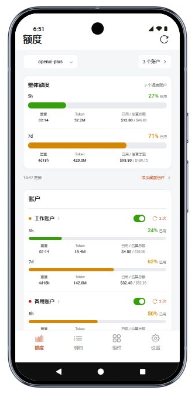
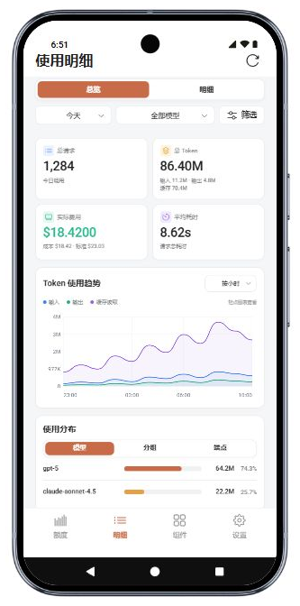
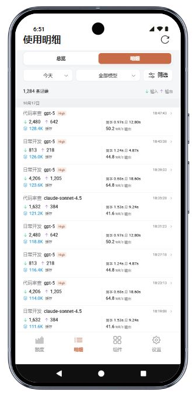
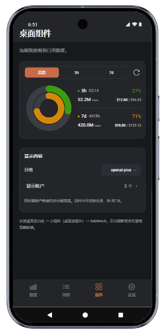

<p align="center">
  
</p>

<h1 align="center">SubWatch</h1>

<p align="center"><strong>额度还有多少，什么时候重置，拿起手机就知道。</strong></p>
<p align="center">面向 Sub2API 的 Android 用量监控应用 · 多账户 · 原生桌面组件 · 浅色 / 深色</p>

## 看看 SubWatch

<table>
  <tr>
    <th width="50%">额度一眼掌握</th>
    <th width="50%">用量有迹可循</th>
  </tr>
  <tr>
    <td align="center"></td>
    <td align="center"></td>
  </tr>
  <tr>
    <td align="center">分清整体和单账户额度，随时查看 5h / 7d 已用比例。</td>
    <td align="center">从今日概况到用量曲线，了解请求与费用的变化。</td>
  </tr>
  <tr>
    <th>每次调用，都有明细</th>
    <th>组件预览，深色也清晰</th>
  </tr>
  <tr>
    <td align="center"></td>
    <td align="center"></td>
  </tr>
  <tr>
    <td align="center">查看模型、Token、缓存和响应速度，支持筛选及调用详情。</td>
    <td align="center">按分组选择账户，在总览、5h 和 7d 之间切换。</td>
  </tr>
</table>

截图来自实际运行的应用界面，使用虚构账户与演示用量，不含个人配置或密钥。右下图为应用内组件预览；Android 桌面组件由原生代码实现。

## 你可以用它做什么

## 功能

- 查看整体与各账户的 5h / 7d 已用比例、重置倒计时、Token 和已用 / 估算总额。
- 调度开关、账户设置、可用重置次数及明确确认后的重置操作。
- 使用统计、趋势、分布、调用明细及筛选。
- 多服务连接，浅色 / 深色 / 跟随系统，本地偏好静默保存。
- 方形与横向原生桌面组件，总览 / 5h / 7d 切换，最多展示五个账户，支持刷新动画及后台刷新。
- AndroidKeyStore + AES-GCM 加密保存连接信息。源码不包含服务密钥或签名文件。

从桌面长按空白处，在小组件列表中选择 SubWatch。部分 ColorOS 桌面的入口为“卡片 → 插件”。

## 先用演示数据体验

无需服务地址或 API 密钥，即可运行截图中的界面：

```powershell
npm ci
npx vite --config docs/readme-demo.vite.config.ts
```

打开 `http://127.0.0.1:4182`。此预览只使用模拟数据，不读取本机配置，也不连接真实服务；不支持连接测试、账户修改或重置操作。

## 开发预览

需要 Node.js 22.18+、npm，建议使用当前 Node.js LTS。

```powershell
npm ci
npm run check:runtime
npx vite --config dev.vite.config.ts
```

开发预览只监听 `127.0.0.1:4173`。当前本机代理读取 `%APPDATA%/ClaudeCodeUsageMonitor/settings.json` 的 `sub2api` 配置，适用于已安装对应 Windows 监控应用的开发环境；没有该本地配置时，仍可构建 APK 或运行模拟数据测试。密钥由本机代理使用，不返回浏览器；开发中的配置修改只保留在进程内存。不要把代理公开到网络。

普通静态构建仅提供界面资源，不能代替 Android 原生桥接或本机代理。网页托管版本需要另行实现服务端数据和凭据处理。

## 构建 Android APK

需要 Windows PowerShell、Android SDK 36、build-tools 36.0.0、JDK 21、Node.js 和 Python 3，无需 Gradle。Android 8.0+，设备需有可用的系统 WebView。

设置本机 `ANDROID_SDK_ROOT`（或 `ANDROID_HOME`）、`JAVA_HOME`，并从本机环境或 CI 的 secret 配置提供 `SUBWATCH_KEYSTORE_PASSWORD`。可选 `SUBWATCH_KEYSTORE_PATH` 指定已有签名文件；默认路径为 `%LOCALAPPDATA%/OnememUsage/signing/local-release.jks`，别名为 `usage`。首次构建会在该路径创建签名文件。保管好文件和密码，覆盖升级必须使用相同签名。

```powershell
powershell.exe -NoProfile -ExecutionPolicy Bypass -File android/build.ps1
```

SDK / JDK 路径也可通过 `-SdkRoot`、`-JdkRoot` 传入。脚本执行运行时完整性、类型检查、前端构建、Java / DEX 编译、APK 对齐与签名验证，产物为 `releases/SubWatch-1.0.0.apk`。

首次安装后，在设置中填写自己的 Sub2API 地址及管理员 API 密钥。仓库不会提供或导入个人配置。

## 检查

```powershell
node --experimental-strip-types --test tests/data.test.mjs tests/reset-flow.test.mjs tests/account-admin.test.mjs tests/appearance.test.mjs tests/preferences.test.mjs
npx playwright test
npm run check:runtime
```

Playwright 浏览器首次使用时可运行 `npx playwright install chromium`。测试使用模拟数据；请勿用真实账户消费重置次数来验证。

## 目录

- `src/`：React 界面及浏览器预览设备运行时。
- `android/src/cc/onemem/usage/`：WebView 桥接、密钥存储、服务访问、桌面组件及后台任务。
- `android/res/`：Android 布局、图标和组件资源。
- `scripts/`：本机开发代理及构建辅助脚本。
- `tests/`：单元测试、浏览器测试及模拟器专用原生绘图检查。
- `docs/`：README 截图与独立的模拟数据预览。

应用使用 React / WebView 界面及 Java 原生能力。本仓库为独立移动端源码，不包含 Windows Rust 项目。

后台更新受 Android 调度和设备省电策略影响，最短 15 分钟。估算总额为总已用费用 / 账户平均已用比例，缺失或零比例时显示未知。

## 凭据与资源

`.gitignore` 排除了本地配置、环境文件、私钥、签名文件、构建产物和本机 QA 截图。请勿把真实凭据加入源码或提交历史。

界面图标使用 Radix Icons（MIT）。SubWatch 启动图标来自 Sub2API 官方 SVG，来源与转换说明见 [public/branding/README.md](public/branding/README.md)。
